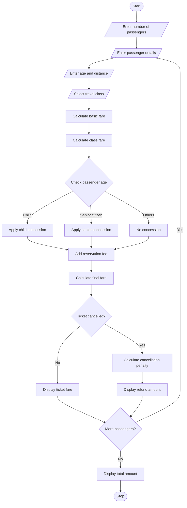

# Railway Fare and Reservation Calculator – Python Program

This program calculates railway ticket fares for multiple passengers based on distance, travel class, age concessions, reservation fees and cancellation charges.

## 1. Problem Statement

Develop a Python program to calculate railway fares for multiple passengers. The program should accept passenger details such as name, age, distance travelled and travel class. It should calculate the ticket fare based on distance slabs and travel class rates. It should also apply age-based concessions for children and senior citizens, add reservation fees and calculate cancellation penalties. Finally, display the total fare for each passenger.

## 2. Algorithm

1. Start the program.
2. Read the number of passengers.
3. Enter passenger name and age.
4. Enter the travelling distance.
5. Select the travel class.
6. Calculate the basic fare based on distance.
7. Calculate the fare according to travel class.
8. Apply age-based concession if applicable.
9. Add reservation fee.
10. Calculate the final ticket fare.
11. Ask whether the ticket is cancelled.
12. If cancelled, calculate the cancellation penalty.
13. Display the final fare for each passenger.
14. Display the total amount.
15. Stop the program.

## 3. Flowchart 

## 5. Sample Input

Enter number of passengers: 2

Passenger 1
Enter passenger name: Ravi
Enter age: 25
Enter distance in km: 200

Select travel class: 1
Cancel ticket? (yes/no): no

Passenger 2
Enter passenger name: Sita
Enter age: 65
Enter distance in km: 300

Select travel class: 2
Cancel ticket? (yes/no): yes

## 6. Sample Output

Passenger Name: Ravi
Basic Fare: 400
Concession: 0
Reservation Fee: 50
Ticket Fare: 450
Ticket Confirmed!

Passenger Name: Sita
Basic Fare: 1200
Concession: 360
Reservation Fee: 50
Ticket Fare: 890
Cancellation Penalty: 222.5
Refund Amount: 667.5

Total Booking Amount: 450

