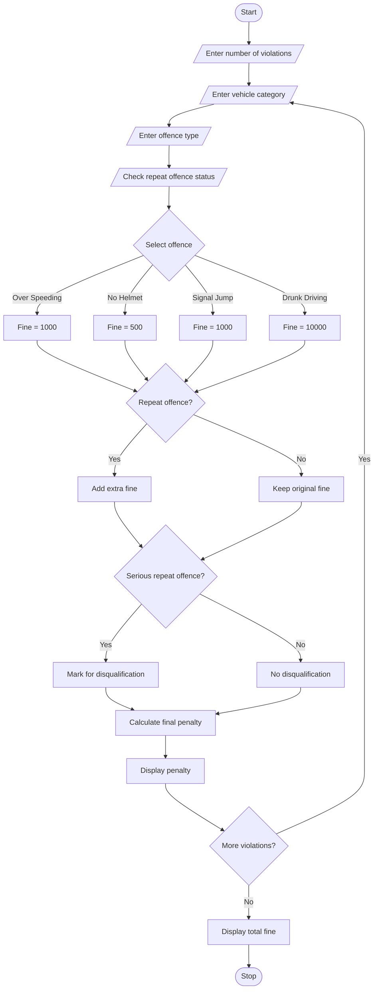

# Traffic Violation Penalty Calculator – Python Program

## 1. Problem Statement

Develop a Python program to calculate traffic violation penalties for multiple vehicles. The program should accept vehicle category, offence type and repeat-offence status. Based on predefined fine rules, calculate the penalty amount. If a driver commits repeated serious offences, identify whether the driver is eligible for licence disqualification. Finally, display the total penalty and disqualification status.

## 2. Algorithm

1. Start the program.
2. Enter the number of traffic violations.
3. Enter the vehicle category.
4. Enter the offence type.
5. Check whether it is a repeat offence.
6. Assign the fine amount based on the offence.
7. Check the vehicle category.
8. Calculate the penalty amount.
9. If it is a repeat offence, add an extra fine.
10. Check disqualification conditions.
11. Display the final penalty.
12. Repeat for all violations.
13. Display the total penalty.
14. Stop the program.

## 3. Flowchart 

## 5. Sample Input

Enter number of violations: 2

Violation 1
1. Two Wheeler
2. Four Wheeler
Select vehicle category: 1

1. Over Speeding
2. No Helmet
3. Signal Jump
4. Drunk Driving
Select offence type: 1

Is it a repeat offence? (yes/no): no

Violation 2
Select vehicle category: 2
Select offence type: 4

Is it a repeat offence? (yes/no): yes

## 6. Sample Output

Violation 1
Final Penalty: 1000

Violation 2
Final Penalty: 20400

Total Traffic Fine: 21400

Driver Disqualification: Required

