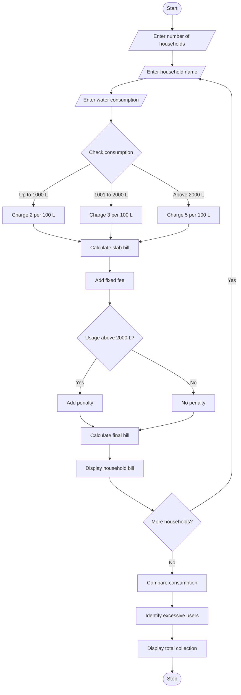

# Progressive Water Tariff Analysis – Python Program

## 1. Problem Statement

Develop a Python program to calculate water bills for multiple households based on their water consumption. The program should calculate charges using different consumption slabs, add fixed fees and penalties for excessive usage. It should compare the water consumption of households and identify households that use more water than the permitted limit. Finally, display the individual bills, total bill amount and excessive water usage details.

## 2. Algorithm

1. Start the program.
2. Enter the number of households.
3. Enter the household name.
4. Enter water consumption in litres.
5. Calculate the bill based on consumption slabs.
6. Add the fixed fee.
7. Check whether consumption exceeds the permitted limit.
8. If usage is excessive, add a penalty.
9. Calculate the final water bill.
10. Display the household name and bill amount.
11. Repeat for all households.
12. Compare the consumption of all households.
13. Identify excessive water users.
14. Display the total collection.
15. Stop the program.

## 3. Flowchart 

## 5. Sample Input

Enter number of households: 3

Household 1
Enter household name: Ravi
Enter water consumption in litres: 800

Household 2
Enter household name: Sita
Enter water consumption in litres: 1500

Household 3
Enter household name: Ramesh
Enter water consumption in litres: 2500

## 6. Sample Output

Household Name: Ravi
Water Consumption: 800 litres
Water Charge: 16.0
Fixed Fee: 50
Penalty: 0
Final Bill: 66.0

Household Name: Sita
Water Consumption: 1500 litres
Water Charge: 35.0
Fixed Fee: 50
Penalty: 0
Final Bill: 85.0

Household Name: Ramesh
Water Consumption: 2500 litres
Water Charge: 55.0
Fixed Fee: 50
Penalty: 100
Final Bill: 205.0

Total Water Bill Collection: 356.0
Number of Excessive Users: 1

