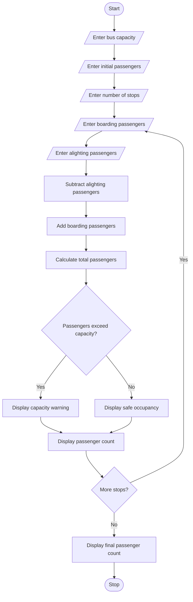

# Bus Passenger Occupancy Simulation – Python Program

## 1. Problem Statement

Develop a Python program to simulate passenger occupancy in a bus across multiple stops. The program should accept the bus capacity, initial passenger count, and the number of passengers boarding and alighting at each stop. It should calculate the total number of passengers after every stop and check whether the bus exceeds its seating capacity. Finally, display the passenger count at each stop and identify any capacity violations.

## 2. Algorithm

1. Start the program.
2. Enter the bus capacity.
3. Enter the initial number of passengers.
4. Enter the number of bus stops.
5. Read the number of passengers boarding at each stop.
6. Read the number of passengers alighting at each stop.
7. Subtract alighting passengers from the current count.
8. Add boarding passengers to the current count.
9. Calculate the total passengers.
10. Check whether passengers exceed bus capacity.
11. If capacity is exceeded, display a warning.
12. Display the passenger count at each stop.
13. Repeat for all stops.
14. Display the final passenger count.
15. Stop the program.

## 3. Flowchart 

## 5. Sample Input

Enter bus capacity: 50
Enter initial passengers: 20
Enter number of stops: 3

Stop 1
Enter boarding passengers: 15
Enter alighting passengers: 5

Stop 2
Enter boarding passengers: 20
Enter alighting passengers: 5

Stop 3
Enter boarding passengers: 10
Enter alighting passengers: 5

## 6. Sample Output

Stop 1
Total Passengers: 30
Bus Capacity is Normal

Stop 2
Total Passengers: 45
Bus Capacity is Normal

Stop 3
Total Passengers: 50
Bus Capacity is Normal

Final Passenger Count: 50
Total Capacity Violations: 0

