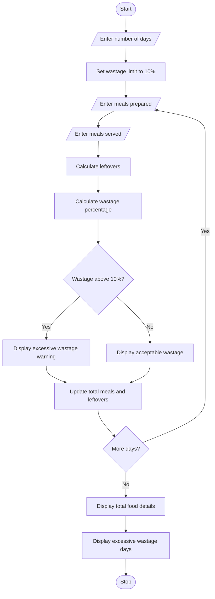

# Food Waste Monitoring System – Python Program

## 1. Problem Statement

Develop a Python program to monitor food waste for several days. The program should accept the number of meals prepared and meals served each day. It should calculate leftover meals and wastage percentages. If the wastage percentage exceeds the acceptable limit, the program should display a warning. Finally, display the total meals prepared, total meals served, total leftovers and identify the days with excessive food wastage.

## 2. Algorithm

1. Start the program.
2. Enter the number of days.
3. Set the acceptable wastage limit to 10%.
4. Set total meals and leftovers to zero.
5. Enter the number of meals prepared.
6. Enter the number of meals served.
7. Calculate leftover meals.
8. Calculate the wastage percentage.
9. Check whether wastage exceeds 10%.
10. If it exceeds 10%, display a warning.
11. Otherwise, display acceptable wastage.
12. Repeat for all days.
13. Display total meals and leftovers.
14. Display the number of days with excessive wastage.
15. Stop the program.

## 3. Flowchart 

## 5. Sample Input

Enter number of days: 3

Day 1
Enter meals prepared: 100
Enter meals served: 95

Day 2
Enter meals prepared: 100
Enter meals served: 80

Day 3
Enter meals prepared: 200
Enter meals served: 170

## 6. Sample Output

Day 1
Leftover Meals: 5
Wastage Percentage: 5.0 %
Food Waste is Acceptable

Day 2
Leftover Meals: 20
Wastage Percentage: 20.0 %
Warning: Excessive Food Waste!

Day 3
Leftover Meals: 30
Wastage Percentage: 15.0 %
Warning: Excessive Food Waste!

Total Meals Prepared: 400
Total Meals Served: 345
Total Leftovers: 55
Days with Excessive Waste: 2

Note: The 10% wastage limit is an assumed value for this educational program. The program assumes that meals served cannot be greater than meals prepared and prepared meals must be greater than zero.
