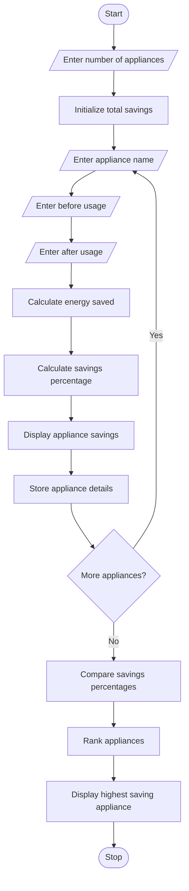

# Energy Conservation Before-and-After Analysis – Python Program

## 1. Problem Statement

Develop a Python program to compare electricity consumption of different appliances before and after an energy-saving intervention. The program should accept appliance names and their electricity usage before and after the intervention. It should calculate the energy saved and savings percentage for each appliance. Finally, rank the appliances based on their savings percentage and identify which appliance achieved the highest energy savings.

## 2. Algorithm

1. Start the program.
2. Enter the number of appliances.
3. Initialize total savings to zero.
4. Enter the appliance name.
5. Enter electricity usage before intervention.
6. Enter electricity usage after intervention.
7. Calculate energy saved.
8. Calculate savings percentage.
9. Display the savings for each appliance.
10. Store the appliance details.
11. Repeat for all appliances.
12. Compare savings percentages.
13. Rank appliances from highest to lowest savings.
14. Display the highest saving appliance.
15. Stop the program.

## 3. Flowchart 

## 5. Sample Input

```
Enter number of appliances: 3

Appliance 1
Enter appliance name: Fan
Enter electricity usage before: 100
Enter electricity usage after: 60

Appliance 2
Enter appliance name: AC
Enter electricity usage before: 300
Enter electricity usage after: 180

Appliance 3
Enter appliance name: Light
Enter electricity usage before: 50
Enter electricity usage after: 40


## 6. Sample Output

Appliance 1
Energy Saved: 40.0 units
Savings Percentage: 40.0 %

Appliance 2
Energy Saved: 120.0 units
Savings Percentage: 40.0 %

Appliance 3
Energy Saved: 10.0 units
Savings Percentage: 20.0 %

--- Appliance Savings Ranking ---

1 Fan Savings: 40.0 %
2 AC Savings: 40.0 %
3 Light Savings: 20.0 %

Highest Saving Appliance: Fan
