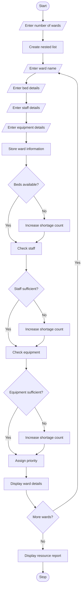

# Hospital Resource Allocation and Capacity Monitoring – Python Program

## 1. Problem Statement

Develop a Python program to monitor hospital resources across multiple wards. The program should use nested lists to store bed occupancy, available staff and medical equipment details. It should identify shortages of beds, staff and equipment in each ward. Based on predefined rules, the program should prioritize wards with more resource shortages. Finally, display the resource availability and priority status of each ward.

## 2. Algorithm

1. Start the program.
2. Enter the number of hospital wards.
3. Create a nested list to store ward details.
4. Enter the ward name.
5. Enter total beds and occupied beds.
6. Enter available staff and required staff.
7. Enter available and required equipment.
8. Store all details in the nested list.
9. Check bed availability.
10. Check staff availability.
11. Check equipment availability.
12. Count the resource shortages.
13. Assign priority based on shortages.
14. Display ward details and priority.
15. Stop the program.

## 3. Flowchart


## 5. Sample Input

Enter number of wards: 2

Ward 1
Enter ward name: Emergency
Enter total beds: 20
Enter occupied beds: 20
Enter available staff: 5
Enter required staff: 8
Enter available equipment: 3
Enter required equipment: 5

Ward 2
Enter ward name: General
Enter total beds: 30
Enter occupied beds: 20
Enter available staff: 10
Enter required staff: 8
Enter available equipment: 8
Enter required equipment: 5


## 6. Sample Output

--- Hospital Resource Report ---

Ward: Emergency
Bed Shortage
Staff Shortage
Equipment Shortage
Priority: HIGH

Ward: General
Beds Available: 10
Staff Available
Equipment Available
Priority: LOW

Hospital Resource Analysis Completed
```

