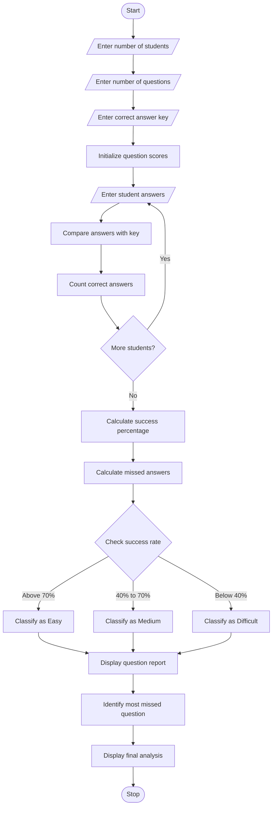

# Examination Question Difficulty and Performance Analysis – Python Program

## 1. Problem Statement

Develop a Python program to analyse student examination performance by comparing student answers with the correct answer key. The program should accept answers from multiple students and calculate question-wise success rates. It should identify the most frequently missed questions and classify each question as Easy, Medium or Difficult based on the success percentage. Finally, display the overall performance report.

## 2. Algorithm

1. Start the program.
2. Enter the number of students.
3. Enter the number of questions.
4. Enter the correct answer key.
5. Create a list to store student answers.
6. Enter answers for each student.
7. Compare student answers with the answer key.
8. Count correct answers for each question.
9. Calculate question-wise success percentages.
10. Identify the most frequently missed questions.
11. Classify questions based on success rates.
12. Display the performance report.
13. Stop the program.

## 3. Flowchart

## 5. Sample Input

Enter number of students: 3
Enter number of questions: 3

Enter correct answers:
Question 1: A
Question 2: B
Question 3: C

Student 1
Answer for Q1: A
Answer for Q2: B
Answer for Q3: C

Student 2
Answer for Q1: A
Answer for Q2: A
Answer for Q3: B

Student 3
Answer for Q1: B
Answer for Q2: A
Answer for Q3: C

## 6. Sample Output

--- Question Performance Report ---

Question: 1
Correct Answers: 2
Wrong Answers: 1
Success Rate: 66.66666666666666 %
Difficulty: Medium

Question: 2
Correct Answers: 1
Wrong Answers: 2
Success Rate: 33.33333333333333 %
Difficulty: Difficult

Question: 3
Correct Answers: 2
Wrong Answers: 1
Success Rate: 66.66666666666666 %
Difficulty: Medium

Most Frequently Missed Questions:
Question 2 - 2 wrong answers

Analysis Completed
