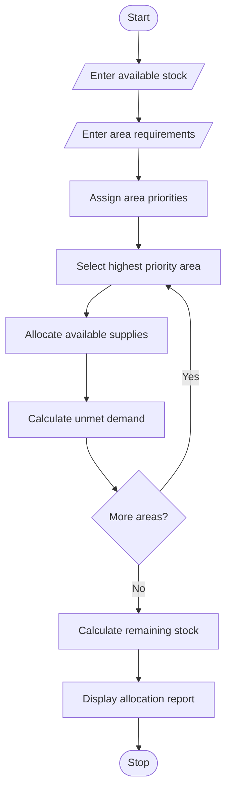

# Disaster Relief Supply Allocation – Python Program

## 1. Problem Statement

Develop a Python program to manage disaster relief supplies for multiple affected areas. The program should accept available stock and area-wise requirements for essential supplies such as food, water and medicines. It should identify urgent shortages and allocate limited supplies according to priority rules. Finally, calculate the allocated supplies and remaining unmet demand for each area.

## 2. Algorithm

1. Start the program.
2. Enter the number of affected areas.
3. Enter the available stock of food, water and medicines.
4. Enter the area name and its requirements.
5. Assign priority to each area.
6. Identify urgent shortages.
7. Allocate supplies to high-priority areas first.
8. Allocate remaining supplies to other areas.
9. Calculate unmet demand.
10. Display allocated supplies for each area.
11. Display remaining stock.
12. Display total unmet demand.
13. Stop the program.

## 3. Flowchart 

## 5. Sample Input

Enter available food stock: 100
Enter available water stock: 150
Enter available medicine stock: 50

Enter number of affected areas: 2

Area 1
Enter area name: Village A
Food required: 80
Water required: 100
Medicine required: 40
Enter priority: 1

Area 2
Enter area name: Village B
Food required: 60
Water required: 80
Medicine required: 30
Enter priority: 2

## 6. Sample Output

--- Disaster Relief Allocation ---

Area: Village A
Food Allocated: 80
Water Allocated: 100
Medicine Allocated: 40
Unmet Demand: 0

Area: Village B
Food Allocated: 20
Water Allocated: 50
Medicine Allocated: 10
Unmet Demand: 90

--- Remaining Stock ---
Food: 0
Water: 0
Medicine: 0

Total Unmet Demand: 90

les are assumed for this educational program. It allocates supplies in the order of priority: High, Medium and Low. If two areas have the same priority, their original input order is maintained.
