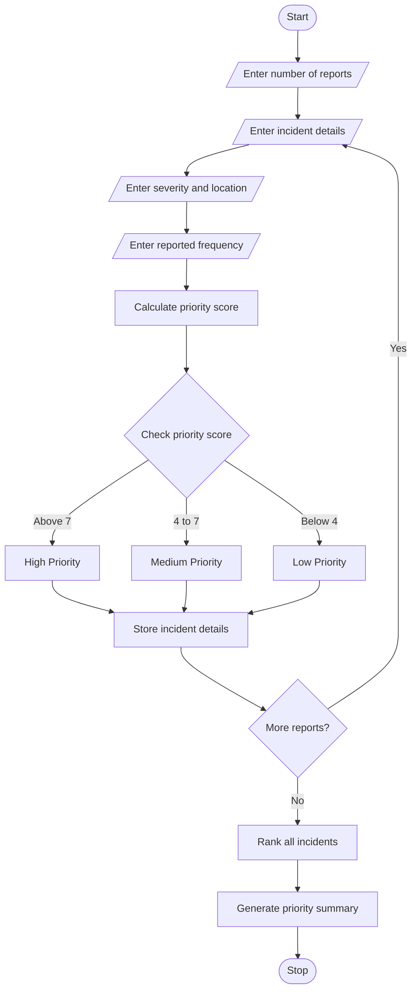

# Smart Campus Incident and Maintenance Prioritization – Python Program

## 1. Problem Statement

Develop a Python program to classify and prioritize campus maintenance reports. The program should accept incident details such as severity, location and reported frequency. Based on predefined rules, it should assign priority levels such as High, Medium and Low. Serious incidents and frequently reported problems should receive higher priority. Finally, rank all incidents and generate a priority summary.

## 2. Algorithm

1. Start the program.
2. Enter the number of maintenance reports.
3. Enter the incident name.
4. Enter the incident severity.
5. Enter the incident location.
6. Enter the reported frequency.
7. Calculate the priority score.
8. Assign priority based on predefined rules.
9. Store all incident details in a list.
10. Repeat for all reports.
11. Rank incidents according to priority score.
12. Count High, Medium and Low priority incidents.
13. Display the priority summary.
14. Stop the program.

## 3. Flowchart 

## 5. Sample Input

Enter number of maintenance reports: 3

Incident 1
Enter incident name: Water Leakage
Enter severity: 1
Enter location: 1
Enter reported frequency: 5

Incident 2
Enter incident name: Fan Repair
Enter severity: 2
Enter location: 2
Enter reported frequency: 3

Incident 3
Enter incident name: Broken Chair
Enter severity: 3
Enter location: 2
Enter reported frequency: 1

## 6. Sample Output

--- Campus Incident Report ---

Incident: Water Leakage
Priority Score: 8
Priority: High

Incident: Fan Repair
Priority Score: 5
Priority: Medium

Incident: Broken Chair
Priority Score: 3
Priority: Low

--- Priority Summary ---
High Priority: 1
Medium Priority: 1
Low Priority: 1

Total Reports: 3
